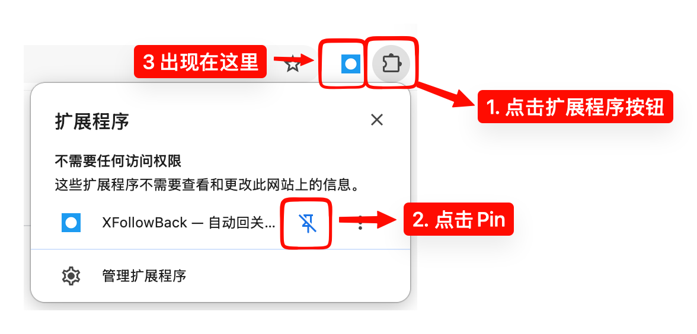

# XFollowBack 使用说明

XFollowBack 是一个 Chrome / Edge 浏览器扩展，帮你在 X（Twitter）上：

1. **自动回关**蓝 V 认证粉丝  
2. **主动关注**互关标签下的蓝 V 候选人  
3. **查看未回关名单**，并可选批量取关  

下面按「安装 → 第一次准备 → 日常使用」说明。不需要懂技术细节。

---

## 一、安装

> 目前尚未上架 Chrome 应用商店，请用「开发者模式」加载安装包。

1. 打开 [Releases 页面](https://github.com/marsbuildlog/x-follow-back/releases/)，下载最新的 `x-follow-back-v{x.y.z}.zip`
2. 解压到一个本地文件夹（之后不要随便移动或删掉这个文件夹）
3. 浏览器打开扩展管理页：
   - Chrome：`chrome://extensions`
   - Edge：`edge://extensions`
4. 右上角打开「开发者模式」
5. 点「加载已解压的扩展程序」，选中刚才解压出来的文件夹
6. （推荐）把扩展固定到工具栏，方便随时打开：

   

更新版本时：下载新包并解压覆盖到同一文件夹后，在扩展页点「重新加载」即可。

---

## 二、第一次使用前要准备什么

### 1. 保持 X 账号 已登录

在浏览器里打开 [x.com](https://x.com) 并登录你要用的账号。

### 2. 打开控制台（最重要）

点扩展图标 → **打开控制台**。

关注循环(回关/主动关注)、抓取(帖子)、连扫(评论)、未回关名单拉取/批量取关，都跑在**控制台页面**上。

> **请尽量一直开着控制台。**  
> 关掉控制台后，长时间任务会停；重新打开控制台后可以再继续。  
> x.com 页面主要用于「监听」请求需要的材料（请求模板、身份验证信息等），不必一直盯着认证关注者页。

### 3. 按「运行所需材料」补齐

控制台「总览」里有一张**运行所需材料**清单。缺哪项会标出来，并提供一键打开对应页面的按钮。常见要做的事：

| 材料 | 你要做什么 |
|------|------------|
| 登录身份 | 打开任意 x.com 页面，让扩展认出你的账号 |
| 用户查询与回关兑底 | 打开引导里的插件作者主页，点一次「关注」（已关注可先取关再关注） |
| 认证关注者与关注列表 | 各打开一次自己的「认证关注者」页和「正在关注」(`/following`) 页，等加载完 |
| 搜索模板（主动关注用） | 打开互关标签页（默认 `#蓝V互关`）旁听一次 |
| 帖子详情模板（主动关注用） | 打开任意一条帖子详情页一次 |

清单上带 ❗ 的尽量先补齐，再开始任务。旁听成功后对应项会自动勾掉。
尽量在如下几个页面多滚动几下:

**主要是目前有一些接口需要使用一个接口id, 目前还没弄清楚怎么伪造, 需要从用户请求里面获取**
- 认证关注者页面,一共滚动10-20页左右, 应该够了, 用于拉回关列表
- #蓝V互关 或者 #浇朋友 这样的标签页面, 一共滚动10-15页左右应该就够了, 主要是需要主动关注的时候拉帖子
- #蓝V互关 或者 #浇朋友 点进去一个评论数量多的帖子, 一共滚动10-15页左右应该就够了, 主要是需要拉取帖子里面评论的用户使用
- 正在关注页面, 一共滚动10-20页左右, 应该够了, 用于拉关注列表(取关用)

---

## 三、自动回关认证关注者

目标：把「关注了你、且是蓝 V、你还没回关」的人，按节奏自动关注回去。

1. 打开**控制台**，确认材料大致齐全  
2. 点击**更新列表**, 拉取认证粉丝、筛出待回关的人，再按设置里的**关注间隔**逐个关注
3. 在「总览」或「回关」页点 **开始回关**  
4. 需要暂停时点 **暂停**，继续时点 **恢复**  
5. 如果回关队列里面没有了用户, 点 **更新列表**, 重新拉取

状态、待处理人数、今日已回关数，可在控制台和 x.com 页面浮层里看到。

**说明：**

- 只处理**蓝 V 认证粉丝**，普通粉丝不会进回关队列  
- 遇到限流会自动等待后重试；触达关注上限会暂停并稍后探测  
- 暂停、上限等重要情况会发浏览器通知（请允许通知权限）

---

## 四、主动关注（可选）

适合想通过「蓝 V 互关」标签主动扩人的场景。

1. 在「设置」里确认**互关标签**（默认有 `#蓝V互关`，可增删）  
2. 按材料清单打开对应标签页、帖子详情，完成请求模板的旁听  
3. 在「主动关注」页：
   - **抓取互关帖**：把上面的**互关标签**的帖子放进帖池  
   - **扫描帖子**：从帖子评论里找蓝 V 候选人入队  
   - **开始主动关注**：按关注间隔逐个关注队列里的人  

回关队列优先于主动关注：两边都在跑时，会先处理回关。

**说明：**

- 帖子和评论拉取都需要tid, 这个需要大家在标签页和帖子详情页面多下拉一些页面, 才可以获得足够多的tid
- 帖子和评论拉取都有一些间隔(防止被系统惩罚), 所以相对比较慢一些
---

## 五、未回关名单与批量取关

「未回关名单」= **你关注了对方，但对方没有关注你** 的人。

### 拉取名单

1. 先打开一次自己的 `x.com/你的账号/following`，等加载完（捕获关注列表模板）  
2. 控制台 → **未回关名单** → **拉取名单**  
3. 保持控制台打开；页间约 5 秒节奏，关注很多时会跑几分钟  

表格里可看账号、昵称（可点进主页）、Bio、粉丝数、关注数、关注/粉丝比例。默认按「关注/粉丝」从小到大排序，点表头可改排序。

### 免取关名单

不想被批量取关的人(比如部分大V)，在未回关名单里点 **加入免取关**。

- 会出现在「免取关名单」Tab  
- 下次拉取未回关名单时会自动跳过这些人  
- 在免取关 Tab 点 **移除**：只离开免取关名单，不会立刻加回未回关；下次再拉取时若仍未回关会重新出现  

**本插件作者会自动从本名单抹除, 如果真心想取关, 可以打开我的个人主页取关**

### 批量取关

1. 确认未回关名单已拉取，并已把要保留的人加入免取关  
2. 点 **批量取关**，确认人数后开始  
3. 按设置里的**批量取关间隔**逐个取关，可随时 **停止取关**  
4. 取关成功的人会从未回关名单里去掉  

也可 **导出 CSV**（导出当前 Tab 的全量数据）。

---

## 六、设置里常用项

控制台 → **设置**（改完自动保存）：

| 设置 | 含义 | 默认 |
|------|------|------|
| 关注间隔 | 回关 / 主动关注时，每人之间随机等待 | 5～10 秒（最低 5 秒） |
| 批量取关间隔 | 批量取关时每人之间随机等待 | 50～60 秒（最低 5 秒） |
| 人为冷却 | 遇到 429 限流后，在重置时刻上再额外等一段时间 | 1 分钟（可设 0 关闭） |
| 自动拉取间隔 | 打开认证粉丝页时，距上次拉取超过该时长会自动补拉 | 30 分钟 |
| 互关标签 | 主动关注的发现范围 | `#蓝V互关` |

间隔设得太短更容易触发限流，建议不要长期顶着最低值狂跑。

---

## 七、使用时请记住

1. **控制台常开** — 任务宿主在控制台，不是随便一个后台页  
2. **先旁听再跑** — 材料清单没齐时，拉取/关注可能失败；按按钮开页补一下即可  
3. **一次一个主账号** — 数据按当前登录账号分开存；换账号前建议先暂停任务  
4. **风险自负** — 自动化可能触犯 X 的使用条款，存在限流、功能受限等风险；请自行评估，作者不承担账号后果  

---

## 八、常见问题

**Q：点了开始没什么反应？**  
A：看控制台「日志」和材料清单。多数是缺模板、未识别账号，或控制台刚关掉过。补齐材料后重试。

**Q：未回关名单粉丝数 / Bio 是空的？**  
A：重新点一次「拉取名单」。旧缓存可能还是旧字段；新拉取会带上 Bio 和计数。

**Q：批量取关会不会动到免取关里的人？**  
A：不会。免取关名单里的人会从拉取结果和批量取关队列里排除。

**Q：tid / 池见底是什么？**  
A：扩展需要旁听页面请求才能继续发接口。若日志提示打开 `/following`，按提示打开自己的关注列表刷一下即可；搜索类任务则打开互关标签页。

**Q：关了所有 x.com 标签页还能跑吗？**  
A：多数 Route 1 直连不再依赖一直开着认证粉丝页，但身份识别、补模板、兑底仍需要偶尔打开 x.com。控制台必须开着。

---

## 需要帮助时

- 本仓库 Issues：<https://github.com/marsbuildlog/x-follow-back/issues>  
- 使用前请再看一眼仓库主页的免责声明  

祝使用顺利。
